# AI switcher — Preview

Ảnh chụp thật của ứng dụng native chạy trên Ubuntu, bản Linux preview v0.12.0. Các tab phản ánh trạng thái hiện có trên máy: một số CLI và Antigravity chưa được cài; ảnh giao diện không đồng nghĩa các luồng đăng nhập đã được kiểm chứng.

## Đủ 8 tab chính

### Claude Code

Thẻ tài khoản, quota 5 giờ và quota tuần. Ảnh phản ánh trạng thái CLI trên máy chụp.

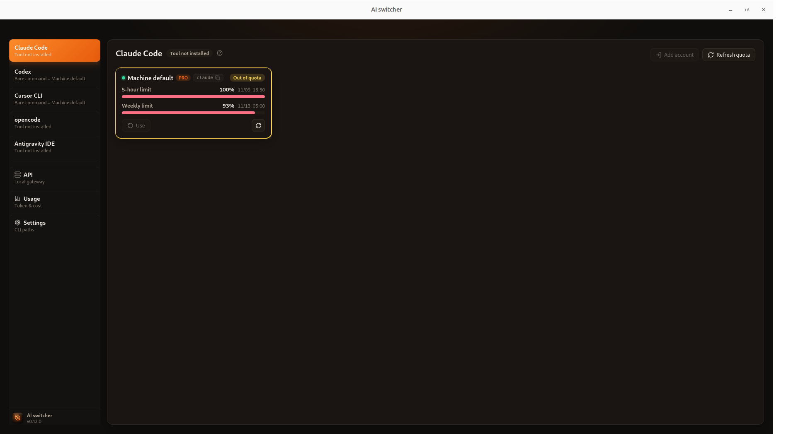

### Codex

Tài khoản đang dùng, hạn mức, thêm tài khoản và làm mới quota.

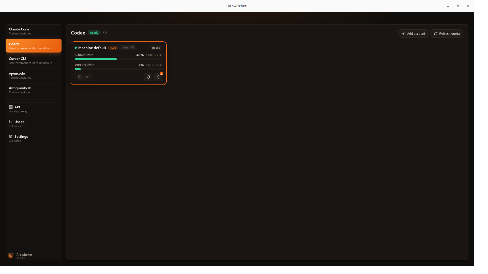

### Cursor CLI

Màn hình quản lý tài khoản Cursor CLI.

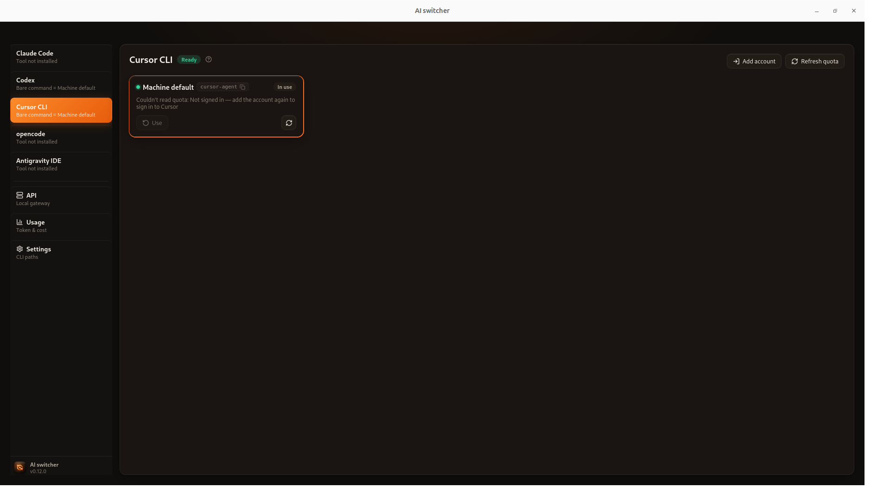

### opencode

Màn hình quản lý tài khoản opencode.

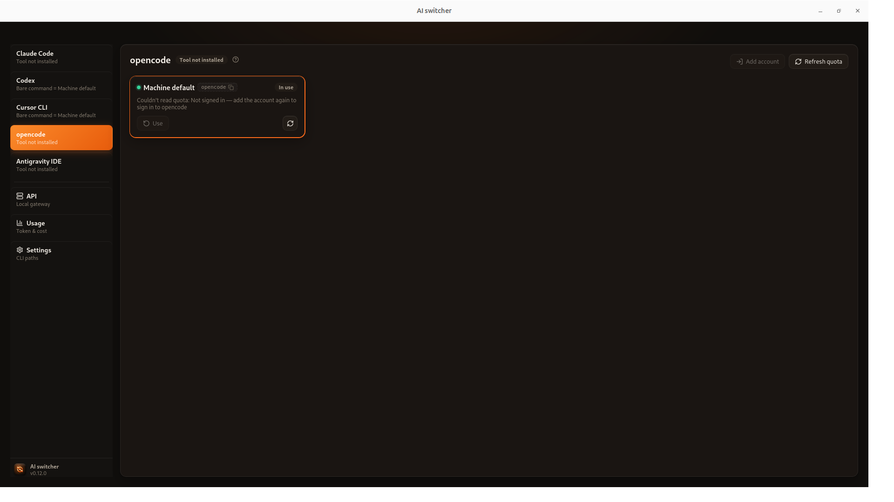

### Antigravity IDE

Màn hình lưu tài khoản và chuyển tài khoản Antigravity. IDE chưa được cài trên máy chụp nên đây là trạng thái chưa có tài khoản.

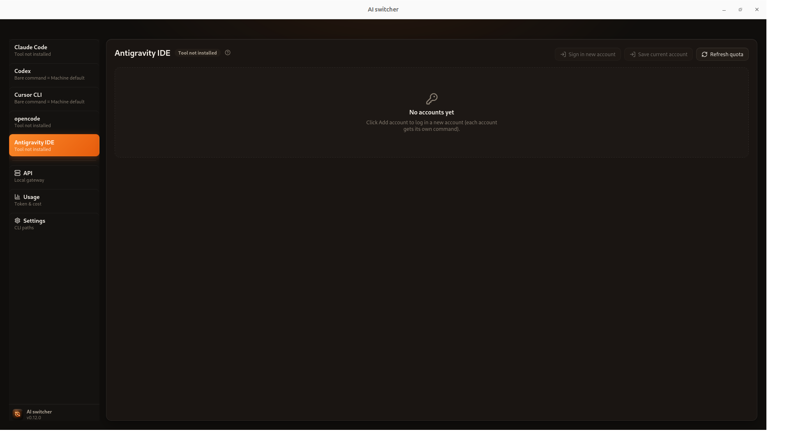

### API gateway

Cấu hình server local, API key, tài khoản phục vụ và model combo. Ảnh chụp khi server chưa khởi động.

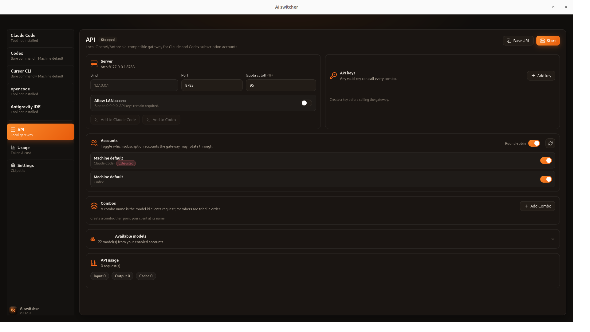

### Usage — Overview

Tổng hợp token, biểu đồ sử dụng và chi phí ước tính từ log local.

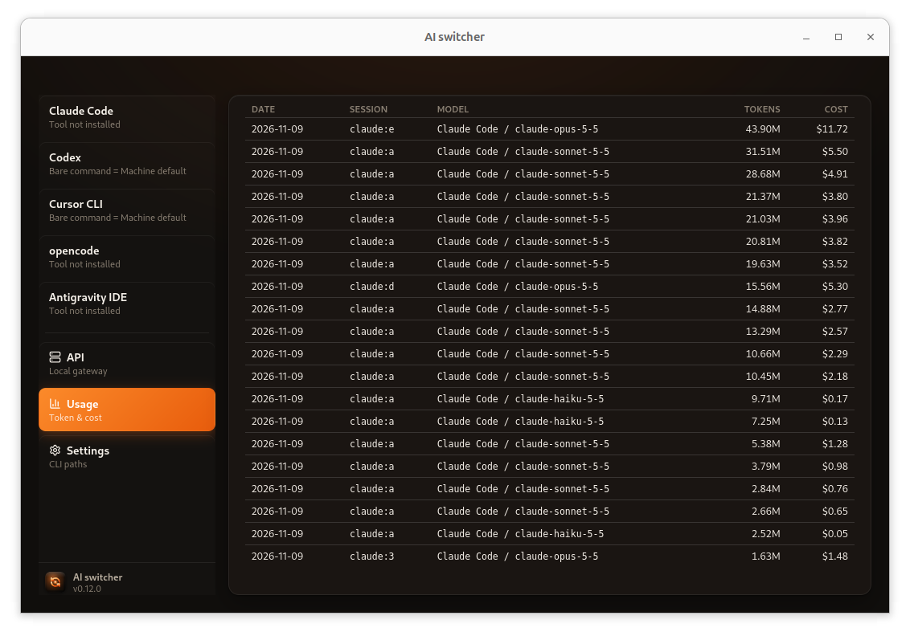

### Settings

Cấu hình đường dẫn CLI, auto-switch và quota overlay.

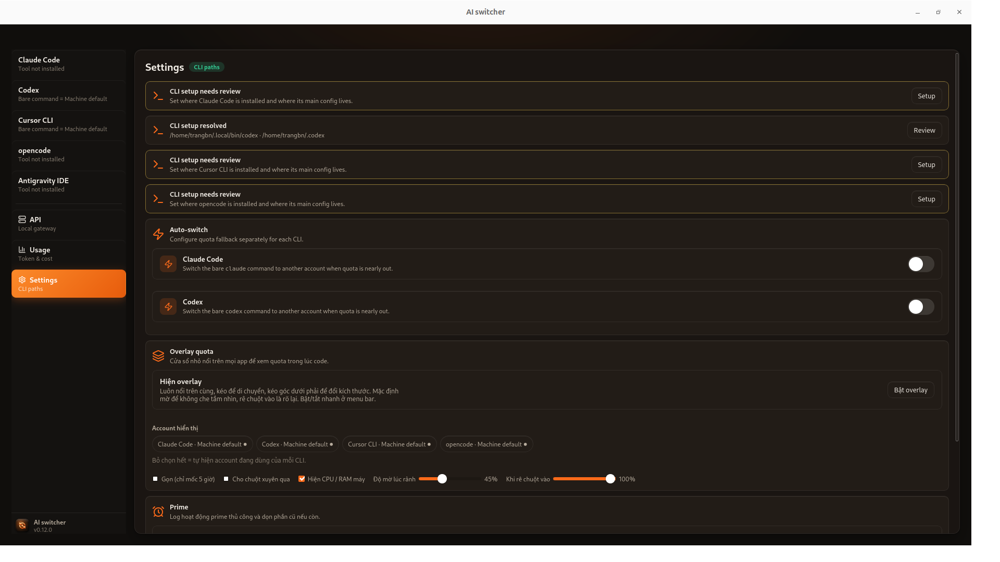

## Các màn hình tính năng

### Usage — Projects

Xem số liệu theo từng project.

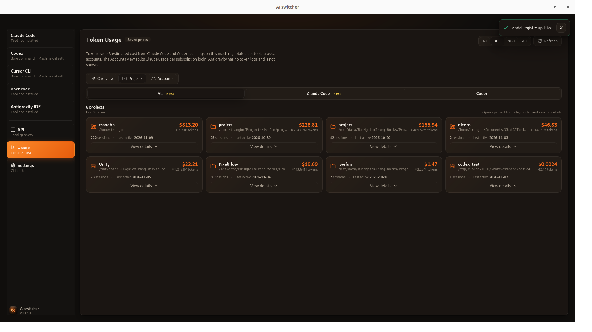

### Usage — Accounts

Cận cảnh tab Accounts và thống kê theo tài khoản; khung ảnh không bao gồm hàng có email cá nhân.

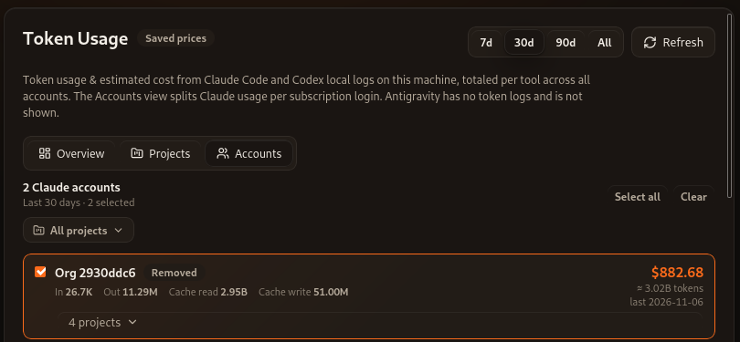

### Thêm tài khoản đăng nhập

Form tạo profile và launcher riêng. Ảnh chụp trước khi gửi form.

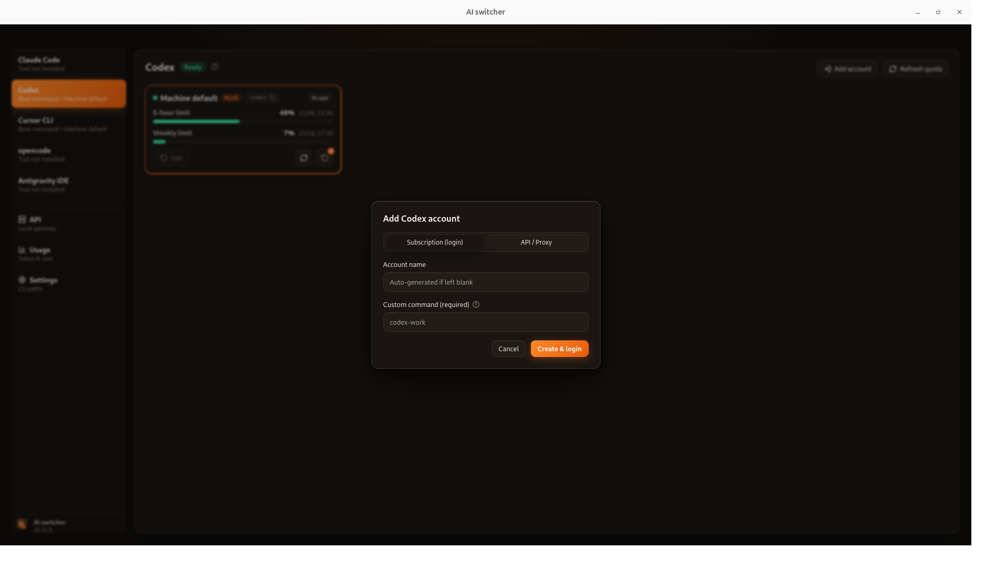

### Thêm tài khoản API / Proxy

Form cấu hình gateway, API key và model. Không có key thật được nhập trong ảnh.

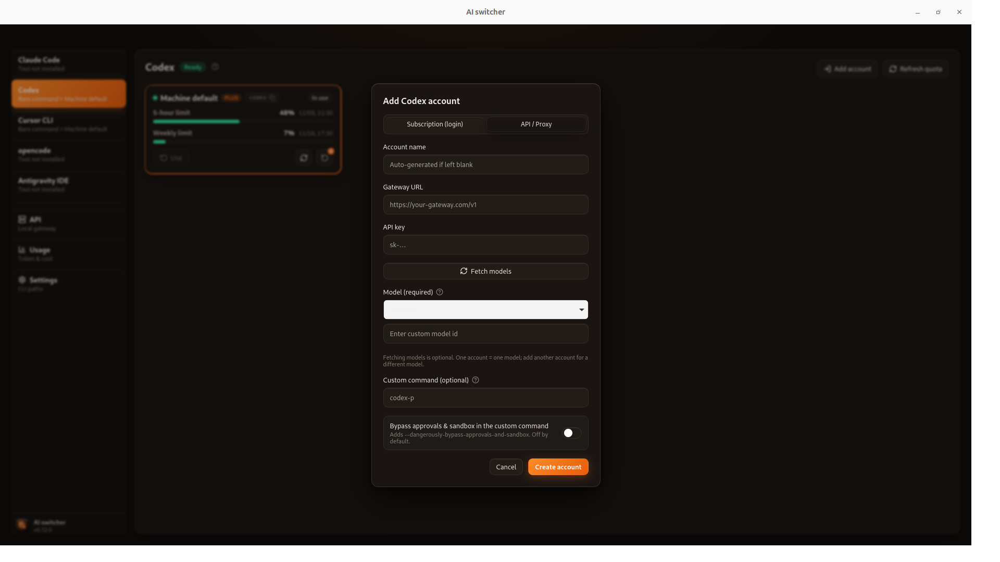

### Tạo API key của gateway

Form đặt tên và hạn dùng của key. Không tạo key để chụp ảnh.

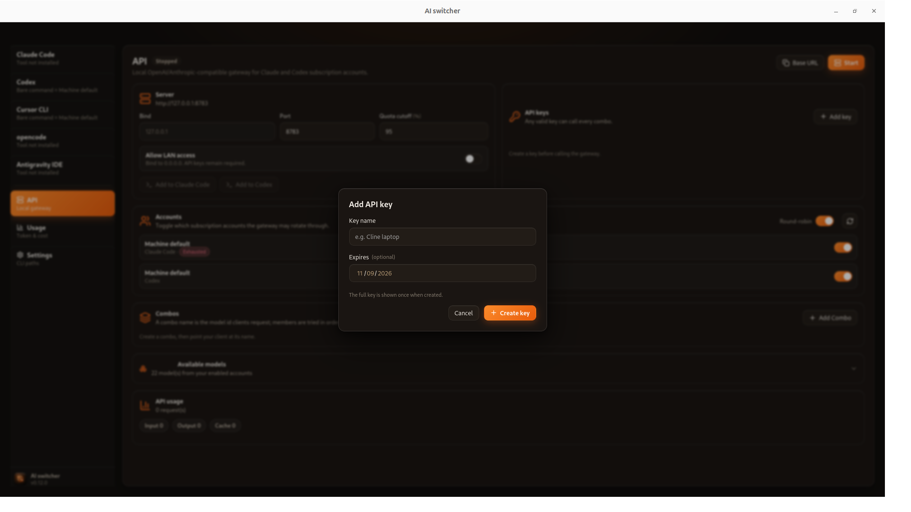

### Tạo model combo

Form cấu hình combo và thứ tự model.

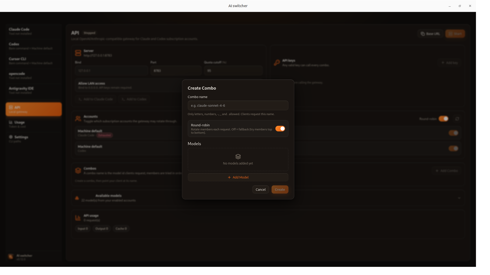

### Cấu hình đường dẫn CLI

Màn hình nhận diện và chọn đường dẫn binary/config, minh họa bằng Codex.

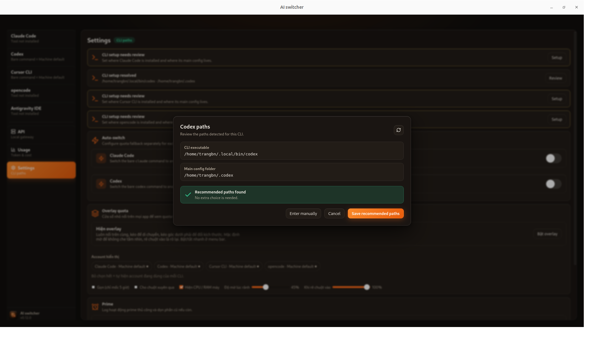

## Tải và cài đặt

[Tải Linux preview](https://github.com/buinghiemtrang/ai-switcher/releases/tag/v0.12.1-linux.1) · [Hướng dẫn cài đặt và phát triển](README.md)

Chi phí hiển thị là ước tính của ứng dụng, không phải hóa đơn nhà cung cấp. Antigravity Linux hiện là tính năng thử nghiệm; luồng đăng nhập và chuyển tài khoản thật cần được kiểm chứng với phiên bản IDE đang sử dụng.
