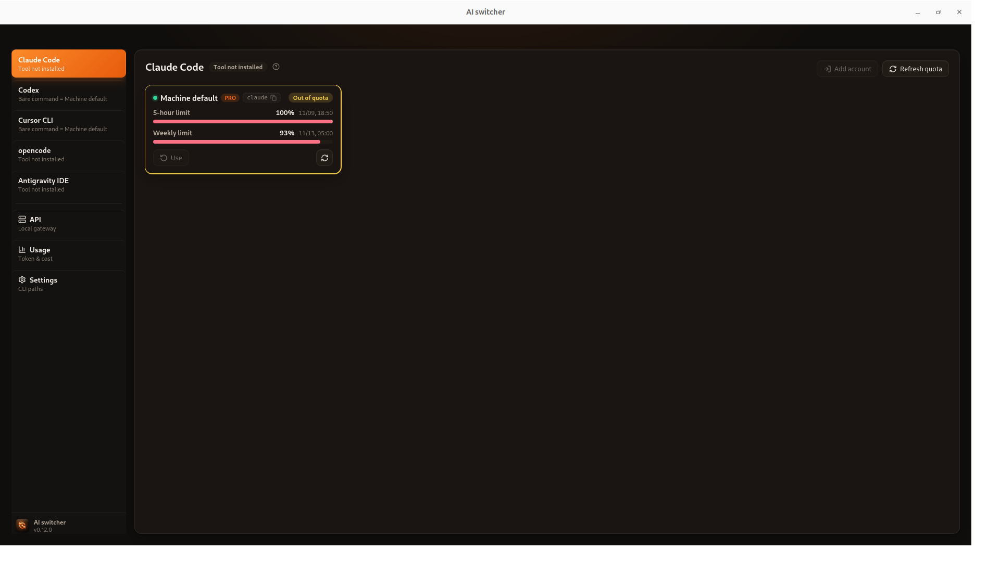
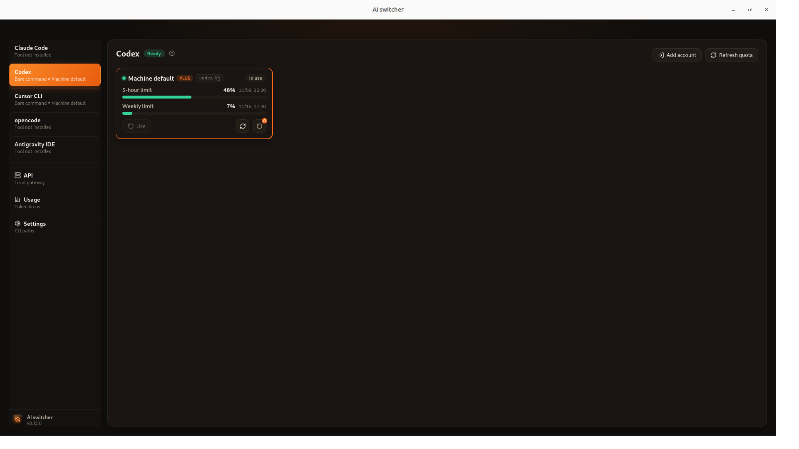
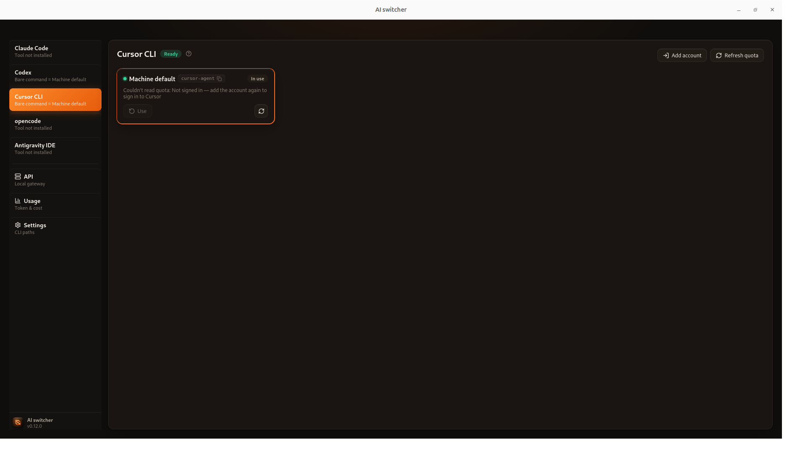
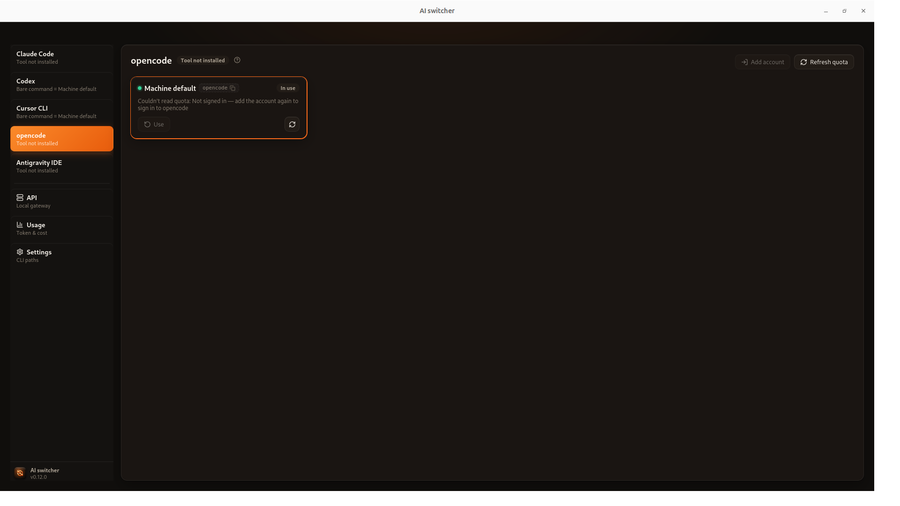

# AI switcher

Independent internal desktop build of an AI coding account manager, built with Tauri 2, Rust and React. This workspace targets Ubuntu 24.04 x86_64. Linux support is being adapted and must pass the checks below before distributing it to colleagues.

## Giao diện ứng dụng

Ảnh chụp native trên Ubuntu của đầy đủ 8 tab chính. [Xem thêm các màn hình tính năng và hộp thoại](PREVIEW.md).

### Claude Code

Thẻ tài khoản, quota 5 giờ và quota tuần. Ảnh phản ánh trạng thái CLI trên máy chụp.



### Codex

Tài khoản đang dùng, hạn mức, thêm tài khoản và làm mới quota.



### Cursor CLI

Màn hình quản lý tài khoản Cursor CLI.



### opencode

Màn hình quản lý tài khoản opencode.



### Antigravity IDE

Màn hình lưu tài khoản và chuyển tài khoản Antigravity. IDE chưa được cài trên máy chụp nên đây là trạng thái chưa có tài khoản.


### API gateway

Cấu hình server local, API key, tài khoản phục vụ và model combo. Ảnh chụp khi server chưa khởi động.


### Usage — Overview

Tổng hợp token, biểu đồ sử dụng và chi phí ước tính từ log local.


### Settings

Cấu hình đường dẫn CLI, auto-switch và quota overlay.


## Install from this repository

This repository is private: colleagues need repository access and must sign in to GitHub.
A downloadable installer is available only after a successful build is published to Releases.
On Ubuntu 24.04 amd64, download the `.deb` from this repository's Releases page, then run:

```bash
sudo apt install "./AI.switcher_0.12.0_amd64.deb"
```

The Linux adaptation is currently a preview. Antigravity Linux support is experimental; close the IDE before switching accounts.
For development or when no installer has been released, follow the source-build steps below.

## Develop on Ubuntu

Clone your repository first (private access requires GitHub authentication):

```bash
git clone https://github.com/buinghiemtrang/ai-switcher.git
cd ai-switcher
```


Install Node.js 20+, a current stable Rust toolchain, and the native build dependencies:

```bash
sudo apt update
sudo apt install build-essential pkg-config libwebkit2gtk-4.1-dev libayatana-appindicator3-dev librsvg2-dev libssl-dev libdbus-1-dev patchelf curl sqlite3 lsof zsh
npm ci
npm run tauri dev
```

A desktop session and a terminal emulator are required for interactive CLI sign-in. Install the AI CLIs you intend to manage separately.

```bash
npm run build
cd src-tauri
cargo test
cd ..
npm run tauri build -- --bundles deb
```

The Debian package is written beneath `src-tauri/target/release/bundle/deb/`. Build and smoke-test the package on the same Ubuntu version used by colleagues before sharing it. `npm run dev` alone is a browser preview with mock accounts; it does not verify native account switching.

## Capabilities and local data

- Manage isolated profiles for AI coding CLI accounts and select the active profile.
- Read provider quota, display usage/cost estimates and offer a local API gateway.
- Account credentials remain on the user's machine; requests to providers use those credentials.
- Selecting accounts can install shell hooks in `.bashrc`/`.zshrc` and per-account launchers in `~/.local/bin`.
- Default CLI profiles and project histories can be shared with managed profiles. Distribute the application package or clean source only, never your app-data folder, account profiles, API keys or CLI credentials.
- Antigravity Linux capture/switching is experimental and requires `sqlite3`. Close all IDE windows before switching or starting a new login; the app backs up the database before changing the token and avatar together. Actual provider login and switching require verification with your installed IDE version before rollout.

## Network behavior

The reviewed application source calls the configured AI providers (`api.anthropic.com`, `chatgpt.com`, `cursor.com`, `opencode.ai`), a local Antigravity service, and user-configured API/proxy endpoints. Cost estimation downloads the public LiteLLM pricing JSON from `raw.githubusercontent.com/BerriAI/litellm`; that download does not include account credentials. AI CLI login commands may open provider authentication pages independently.

The source review found no telemetry SDK, automatic application updater, or runtime upload endpoint belonging to the original author. This is a source review, not a guarantee about dependencies or future modifications. The former promotional blog button has been removed.

The optional gateway defaults to `127.0.0.1:8783` and uses gateway API keys. Binding it to `0.0.0.0` exposes an HTTP service to the network; use company-managed network protection if enabling that mode. Each employee can run their own local installation without sharing credentials.

## Internal distribution

The GitHub workflow builds and tests on pushes and pull requests, then stores the Debian package as an artifact. To publish a downloadable preview installer, run the workflow manually with a new `release_tag` (for example `v0.12.0-linux.1`). The release job runs only after build and tests succeed. A blank tag only builds an artifact. Review and test installers before company rollout.

Before a rollout, verify startup, CLI detection, login, quota refresh, account switching, launchers, gateway authorization, and restart persistence using dedicated test accounts. Real provider authentication cannot be verified without those accounts.

## License

This fork retains the original MIT license and copyright notice in [LICENSE](LICENSE). Keep that file with source distributions and substantial copies of the software.

## Verification of Linux preview

Commit `39eed0b` passed the frontend build, all 112 Rust tests, and Ubuntu Debian packaging in GitHub Actions run `42605079746`. The native application was started on the development desktop with no startup error in the captured log. Actual UI interactions and real provider authentication/account switching still require testing, especially Antigravity with the installed IDE version. The installer includes the MIT notice at `/usr/share/doc/ai-switcher/copyright`.
