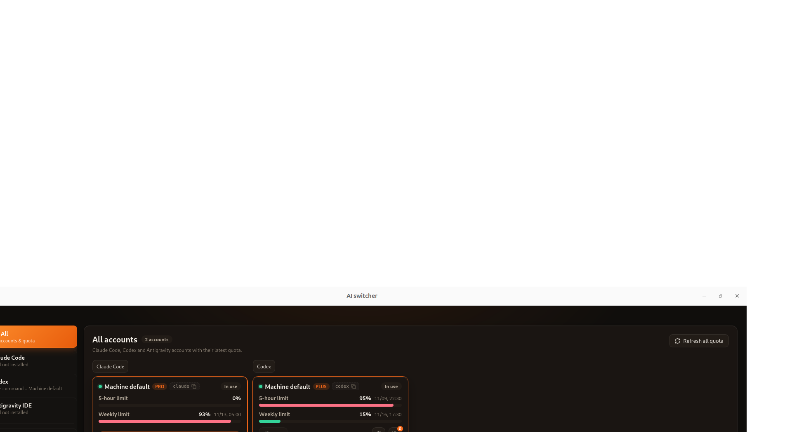
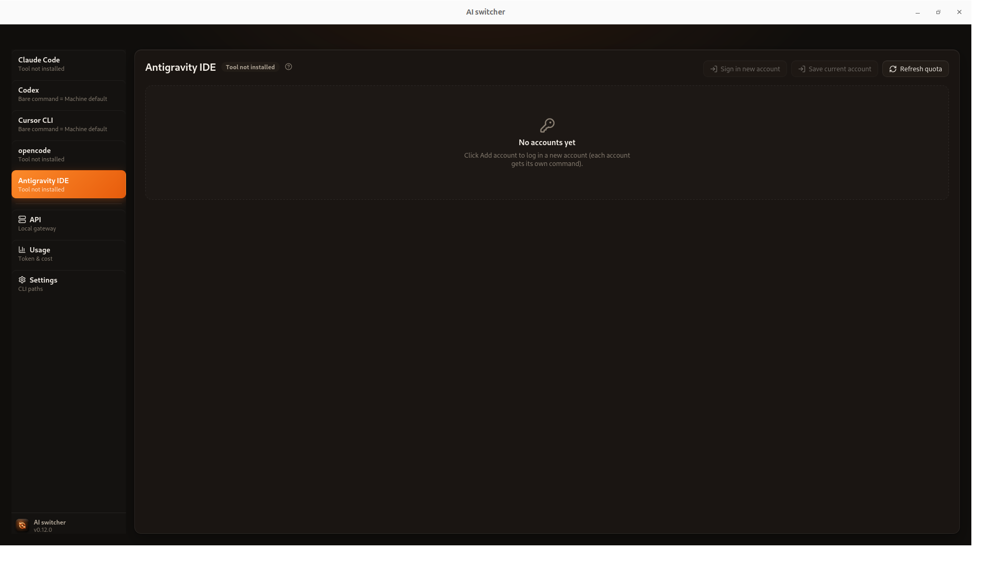
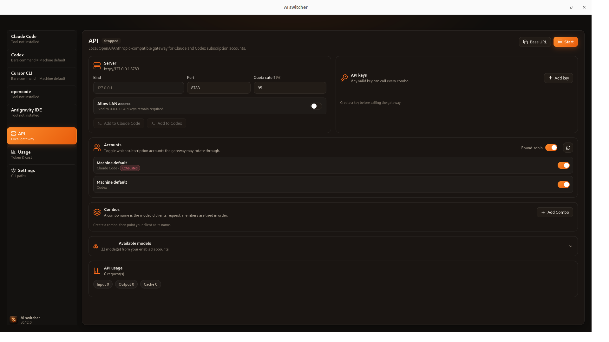
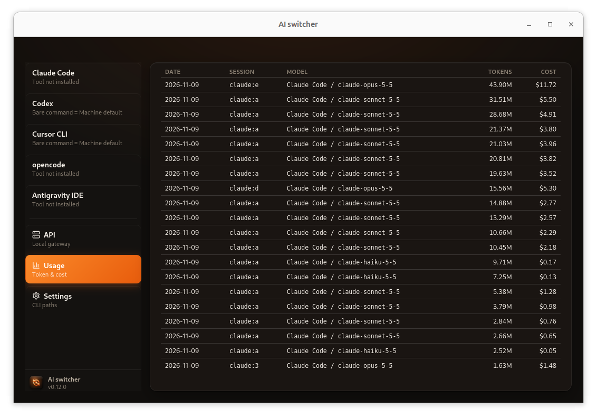
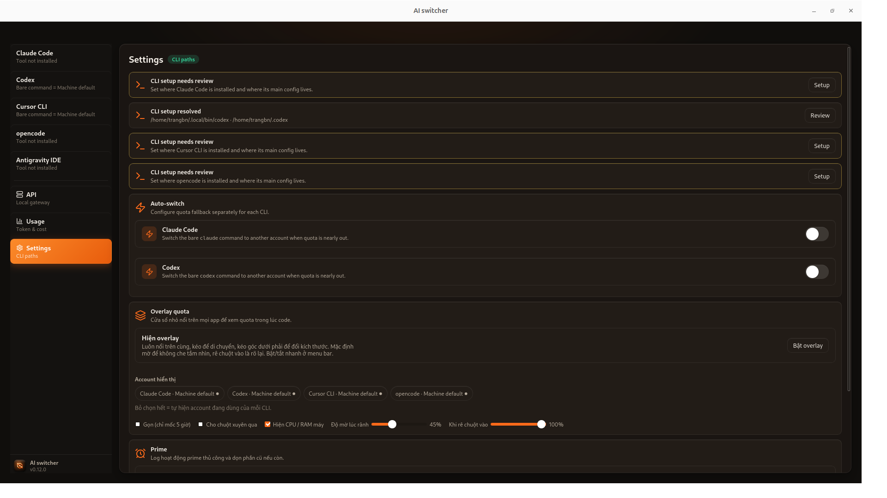

# AI switcher

Quản lý tài khoản Claude Code, Codex và Antigravity trên Ubuntu. Theo dõi quota, token, chi phí ước tính và dùng API gateway local.

## Cài đặt

Bản hiện tại: **Linux preview · Ubuntu 24.04 · x86_64 (amd64)**. Chọn **một** trong hai cách dưới đây.

Repo đang để **private**: bạn cần được cấp quyền truy cập GitHub của repo này.

### Cách 1 — Cài và mở bằng npx

Cần **Node.js 20+**, **Git** và **GitHub CLI (`gh`)**. Nếu máy chưa có các công cụ này, dùng file `.deb` ở cách 2.

Đăng nhập GitHub một lần (nếu máy chưa đăng nhập):

```bash
gh auth login
gh auth setup-git
```

Cài và mở ứng dụng:

```bash
npx --yes github:buinghiemtrang/ai-switcher
```

Launcher tải bản Linux đã build sẵn, kiểm tra SHA-256 và cài vào tài khoản hiện tại. Sau đó mở lại từ menu ứng dụng **AI switcher**.

### Cách 2 — Cài bằng file .deb

1. Mở **[trang tải AI switcher](https://github.com/buinghiemtrang/ai-switcher/releases/tag/v0.12.2-linux.1)**.
2. Trong **Assets**, tải file **`AI.switcher_0.12.2_amd64.deb`** về thư mục **Downloads**.
3. Mở Terminal và chạy:

```bash
cd ~/Downloads
sudo apt install "./AI.switcher_0.12.2_amd64.deb"
```

4. Tìm **AI switcher** trong menu ứng dụng và mở lên.

### Bắt đầu sử dụng

Cài công cụ AI bạn muốn dùng, mở AI switcher, kiểm tra đường dẫn CLI trong **Settings** rồi thêm tài khoản ở tab tương ứng. Mỗi người dùng tài khoản và dữ liệu local riêng trên máy mình.

Antigravity Linux hiện là tính năng thử nghiệm; đóng IDE trước khi chuyển tài khoản.

## Giao diện ứng dụng

Ảnh chụp native trên Ubuntu của đầy đủ 7 tab chính. [Xem thêm các màn hình tính năng và hộp thoại](PREVIEW.md).

### All — Tất cả tài khoản

Màn hình mặc định tổng hợp tài khoản Claude Code, Codex và Antigravity, hiển thị quota từng tài khoản và nút **Refresh all quota**.



### Claude Code

Thẻ tài khoản, quota 5 giờ và quota tuần. Ảnh phản ánh trạng thái CLI trên máy chụp.


### Codex

Tài khoản đang dùng, hạn mức, thêm tài khoản và làm mới quota.


### Antigravity IDE

Màn hình lưu tài khoản và chuyển tài khoản Antigravity. IDE chưa được cài trên máy chụp nên đây là trạng thái chưa có tài khoản.



### API gateway

Cấu hình server local, API key, tài khoản phục vụ và model combo. Ảnh chụp khi server chưa khởi động.



### Usage — Overview

Tổng hợp token, biểu đồ sử dụng và chi phí ước tính từ log local.



### Settings

Cấu hình đường dẫn CLI, auto-switch và quota overlay.



## Dành cho lập trình viên

Xem [hướng dẫn chạy source, build và phát hành](DEVELOPMENT.md).

## Giấy phép

[MIT](LICENSE). Giữ thông báo bản quyền và giấy phép khi phân phối lại.
